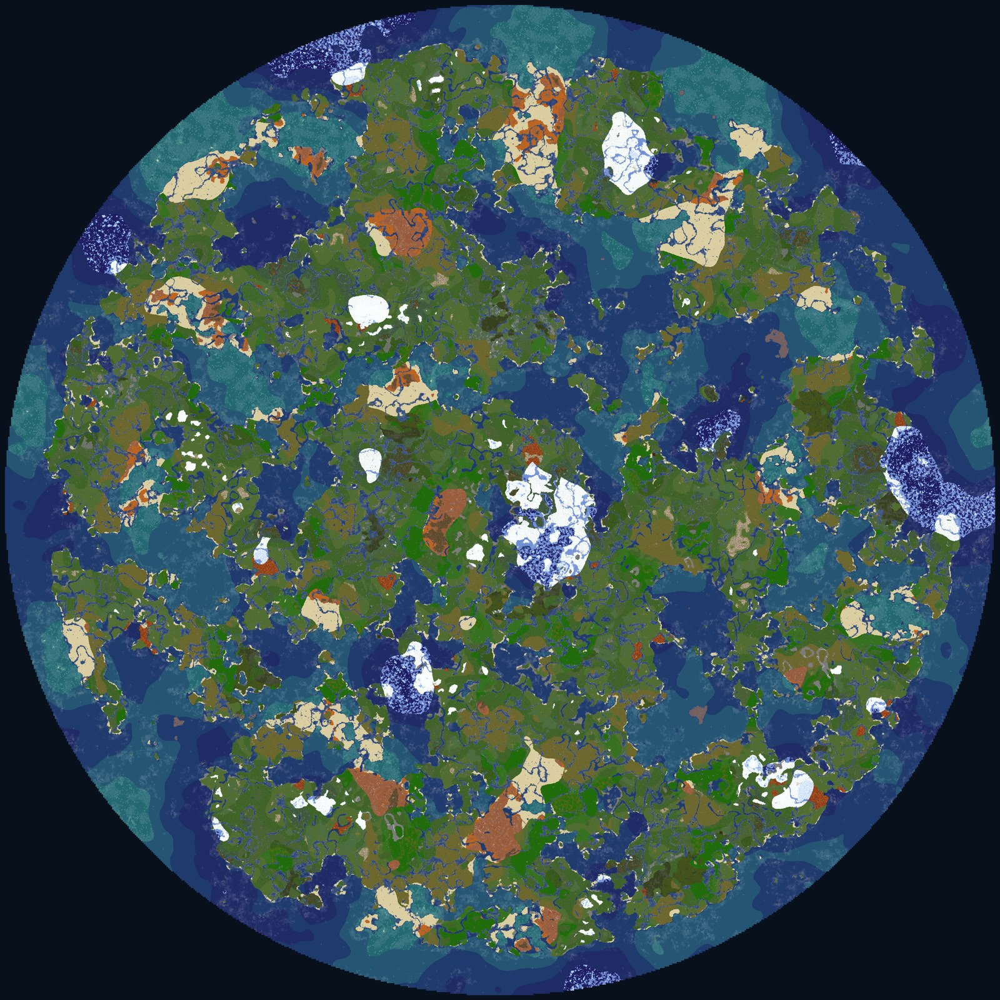
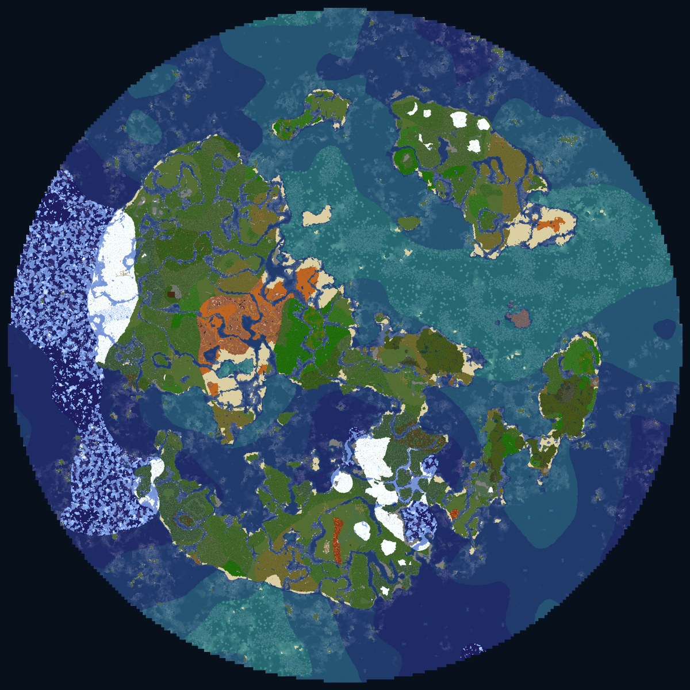
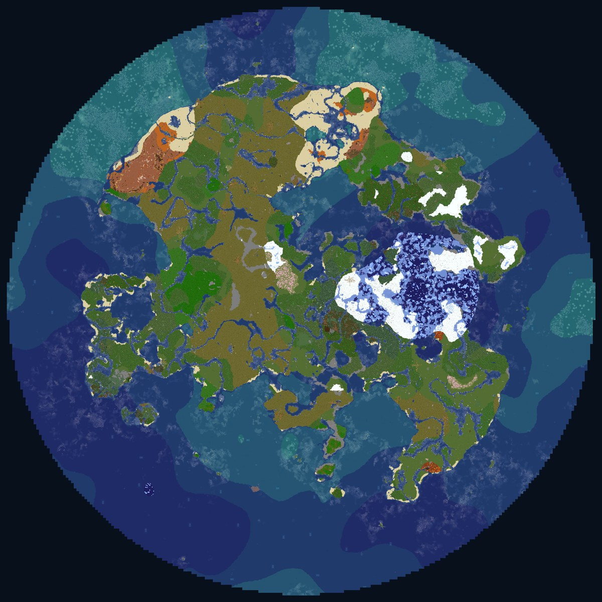
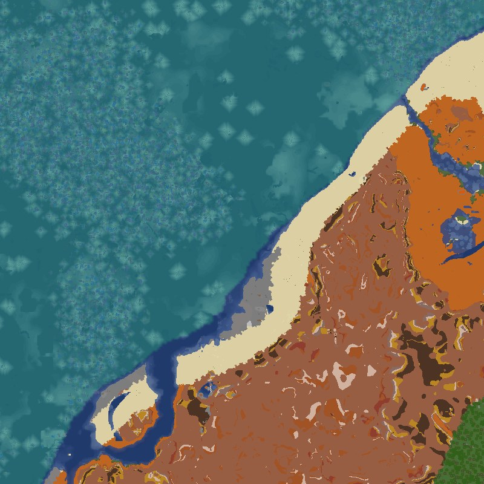
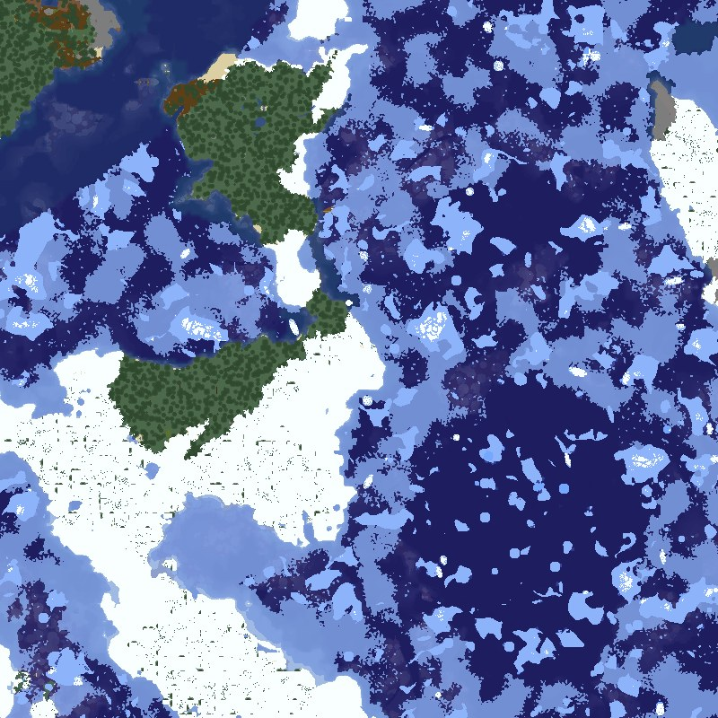
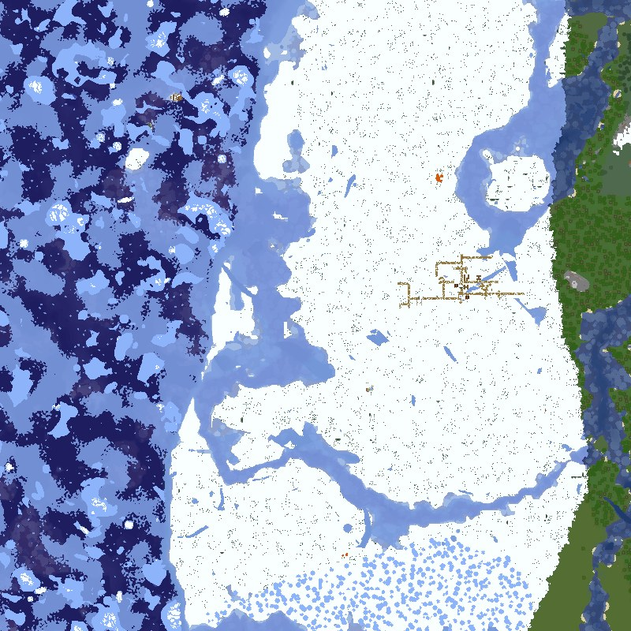
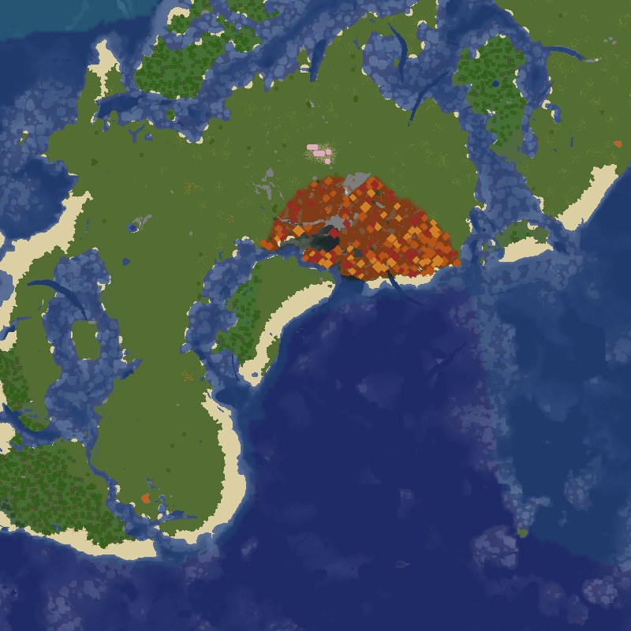

# Finite World

A Fabric mod that adds a **Finite** world type: one landmass of a chosen radius inside an endless vanilla ocean, with every vanilla Overworld land biome and structure guaranteed to appear on it at least once.

The land is vanilla terrain at vanilla scale, different for every seed. The mod only changes two things on top of it:

- **The edge.** Past the radius, land is pushed below sea level. The coastline follows the terrain: beaches and bays on lowland, sea cliffs where mountains meet the edge. The ocean, caves and underground structures continue without limit.
- **Biome anchors.** A few small, seeded nudges to vanilla's climate noise make sure no biome or structure on the checklist is missing inside the radius.

**Why?** An endless world never runs out, so nothing on it is scarce and nowhere is far. A finite island gives a world a shape: a coastline you can sail around, a map you can fill in completely, and neighbours on a server who share the same land instead of spreading out forever. The guarantee keeps that from costing anything: you won't need to leave the island to find a jungle, a mesa or an ancient city.

> **Status:** early development, but playable. The edge, spawn on land, the radius setting and the structure guarantee work. Steering climate toward missing biomes ([ANC-3](docs/tickets/ANC-3.md)) and a more natural coastline ([EDGE-2](docs/tickets/EDGE-2.md)) are in progress. See the [plan](docs/PLAN.md) and the full [design](docs/design.md).

## Showcase

Top views of whole Finite worlds, pre-generated with [Chunky](https://modrinth.com/plugin/chunky) and rendered with [BlueMap](https://modrinth.com/plugin/bluemap) on the [test server](#test-server). The dark border is where generation stopped, 512 blocks past the radius; the ocean itself never ends.

**Radius 10,000, seed 12345.** Twenty kilometres across: 1.7 million chunks, 12 GB of world.



**Radius 3,000, the smallest size, with two different seeds.** Same settings, different land: one breaks into a ring of islands, the other is a single continent.

| Seed 777 | Seed 2026 |
| --- | --- |
|  |  |

**Close-ups**, 1 block per pixel, 800 × 800 blocks each:

| | |
| --- | --- |
|  |  |
| Badlands meeting a warm ocean on seed 2026's northwest coast | Ice spikes and frozen ocean in seed 2026's east |
|  |  |
| A snowy village on seed 777's frozen west coast | The south coast of seed 2026: beaches and bays where the land meets the edge |

## Installing

1. Install [Fabric Loader](https://fabricmc.net/use/) for Minecraft 26.3.
2. Put [Fabric API](https://modrinth.com/mod/fabric-api) and `finiteworld-1.0.0.jar` in your `mods` folder. There is no published release yet: build the jar with `./gradlew build` (see [Development](#development)); it lands in `build/libs/`.
3. Start the game, open **Create World**, and under **World Type** pick **Finite**. Set the radius with **Customize** (default 4,000 blocks, from 3,000 to 20,000). The radius is fixed once the world is created. Normal worlds are not affected.

On a dedicated server, install the same two jars in the server's `mods` folder and set the world type in `server.properties` before the world is first created:

```properties
level-type=finiteworld\:finite
generator-settings={"radius"\:5000}
```

## Requirements

| | Version |
|---|---|
| Minecraft | 26.3 |
| Fabric Loader | 0.20.1 or newer |
| Fabric API | required |
| Java | 25 |

## Development

Requires JDK 25 (`JAVA_HOME` pointing to it). Use the Gradle wrapper; no global Gradle install is needed.

```sh
./gradlew build       # build the mod jar into build/libs/ (runs unit and game tests)
./gradlew runGameTest # only the game tests
./gradlew runClient   # start Minecraft with the mod
./gradlew runServer   # start a dedicated server with the mod
```

On Windows use `gradlew.bat` in place of `./gradlew`.

`./gradlew build` also runs the guarantee check (`src/gametest/`, a Fabric server game test, about 35 seconds). For 20 fixed seeds at radius 3,000, 4,000 and 5,000 it asserts that no land rises above sea level past the radius, and it logs which checklist biomes it found inside the radius (lines starting with `[TEST-1]`).

| Path | Contents |
|---|---|
| `src/main/` | Common and server code, worldgen data |
| `src/client/` | Client-only code (Create World screen) |
| `src/gametest/` | Fabric game tests (guarantee check across seeds) |
| `docs/` | Design documents |
| `.claude/skills/` | Agent skills for Fabric modding, worldgen, Gradle and JUnit |

Versions live in `gradle.properties`; check current ones at <https://fabricmc.net/develop>. Fabric's developer docs are at <https://docs.fabricmc.net/develop/>.

## Test server

A standalone server for pre-generating whole Finite worlds and viewing them in a browser, outside the repo; see the [test server plan](docs/TEST-SERVER-PLAN.md). `mods/` holds the built `finiteworld-1.0.0.jar`, Fabric API, [Chunky](https://modrinth.com/plugin/chunky) and [BlueMap](https://modrinth.com/plugin/bluemap) (versions in [SRV-1](docs/tickets/SRV-1.md)). None of them is a dependency of the mod.

```properties
level-name=r3000
level-seed=12345
level-type=finiteworld\:finite
generator-settings={"radius"\:3000}
```

Set `accept-download: true` in `config/bluemap/core.conf`; the map is then at <http://localhost:8100>.

`bash tools/test-server/pregen.sh <server-dir> 3000 [more radii...]` (Git Bash) creates each world `rN` and pre-generates it with Chunky out to radius + 512; finished worlds are skipped and interrupted ones resume. `python tools/test-server/markers.py <server-dir> 3000 build/run/gameTest/logs/latest.log` then adds BlueMap markers for the radius, spawn, the biome anchors and every structure (run `./gradlew build` first for the anchors, and `bluemap reload` on the server after).

`python tools/test-server/mapshot.py <server-dir>/bluemap/web/maps/rN <lod> out.jpg [--crop X0 Z0 X1 Z1] [--width PX]` stitches a rendered map's low-res tiles into one top-view image (lod 1 is 1 block per pixel, each next lod 5 times coarser); the [showcase](#showcase) images were made with it. Add `SEED=777` before `pregen.sh` for a world with another seed, named `rN-s777`.

## AI usage

This mod was made with AI. Its code, tests and documentation were written with [Claude](https://www.anthropic.com/claude) (Anthropic) through Claude Code, with the author directing the design and reviewing the changes. The agent skills it used are in `.claude/skills/`. The worldgen is checked by the game tests above and by generating and inspecting whole worlds on the [test server](#test-server), but expect the bugs of any early-development mod.

## License

[CC0 1.0](LICENSE): public domain. You may copy, modify, redistribute, include in modpacks and sell this mod, in whole or in part, without asking and without credit. Where a public domain dedication isn't legally possible, CC0 grants the same freedoms as a licence.
