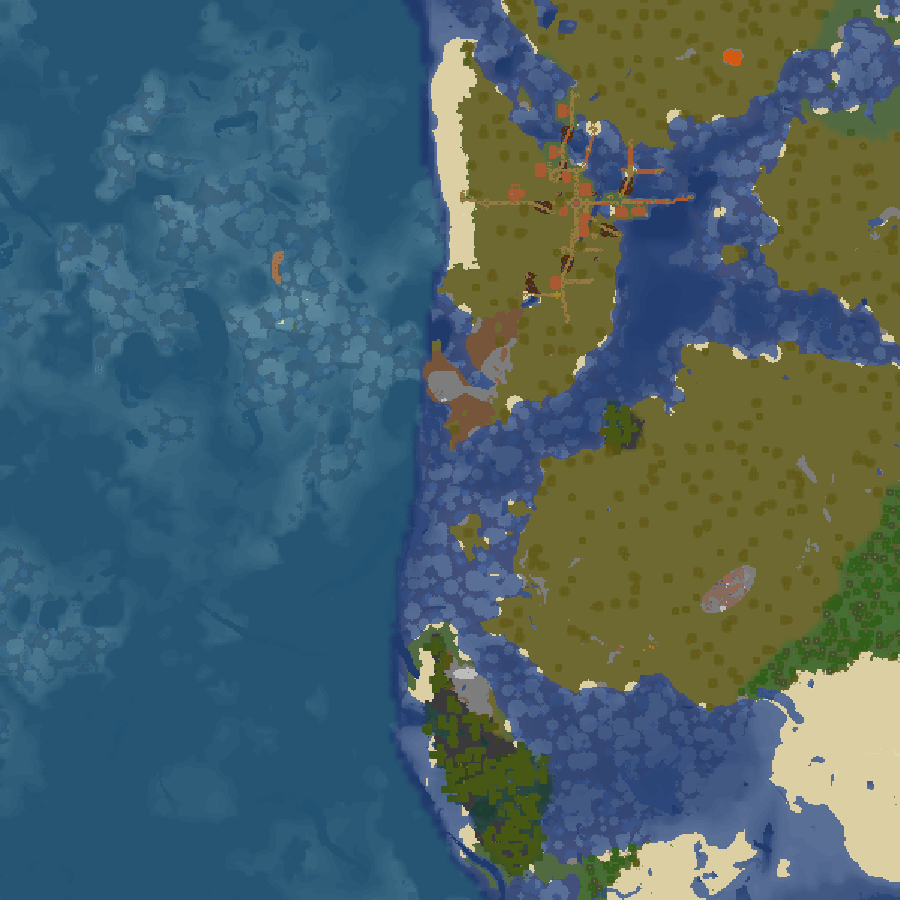

# EDGE-3 · Coast traces the circle along the west of seed 12345 at radius 3000

**Priority:** P2 · **Area:** Edge · **Type:** Bug fix

## User story

As a player, I want the coast never to read as part of a circle on a map, so the world's edge looks natural (design: "You notice the radius only on a map, never as a perfect circle").

## Description

SRV-4's map of `r3000` (seed 12345, radius 3,000) shows the west coast as a near-straight line for about 1,700 blocks, from about (-2,690, -700) to (-2,690, 1,000). At that radius such a line is an arc of a circle: on the rays from 170° to 180° the coast sits at radius 2,628 to 2,700. The rest of the coast wanders as EDGE-2 intends. Find why this stretch follows the circle and fix it without letting land past the radius.

## Current situation (as-is)

-  600 × 600 blocks centred on (-2,648, 185), 1 px per block from BlueMap's low-res tiles: the land and the near-shore water end along one straight north–south line. The whole map is in [SRV-4](SRV-4.md).
- The outline is [`edge_outline`](../../src/main/resources/data/finiteworld/worldgen/noise/edge_outline.json) noise (octaves -9 to -7, wavelengths 512 to 128 blocks), used by [`continents.json`](../../src/main/resources/data/finiteworld/worldgen/density_function/overworld/continents.json) with `outline_depth` 300.
- [`EdgeFalloff.inset`](../../src/main/java/io/github/kevhauma/finiteworld/edge/EdgeFalloff.java) is `depth * clamp(0.5 + 0.5 * outline, 0, 1)`. Wherever the noise is at or below -1, or at or above 1, the inset is constant (0 or 300), so the band's edge is a circle there. This is the first thing to check, not a confirmed cause.

## Desired result (to-be)

- No stretch of coast longer than a few hundred blocks follows a circle on seed 12345 at radius 3,000, or on TEST-1's seeds.
- The hard rule still holds: no land past the radius.

## Acceptance criteria

- [ ] The cause is found and written here (clamped outline noise, or something else).
- [ ] A unit test pins the fix (e.g. the inset still varies where the outline noise saturates).
- [ ] TEST-1 still passes: no land past the radius on any tested seed.
- [ ] Verified on the test server map: `r3000` regenerated with the fix shows no circular stretch on the west coast. Screenshot linked here.
- [ ] `./gradlew build` passes.

## Notes

- Found by [SRV-4](SRV-4.md). Related to [EDGE-2](EDGE-2.md), whose wandering outline this stretch defeats.
- The test server's `r3000` has to be regenerated to check the fix: delete `r3000` and run `tools/test-server/pregen.sh` again.
