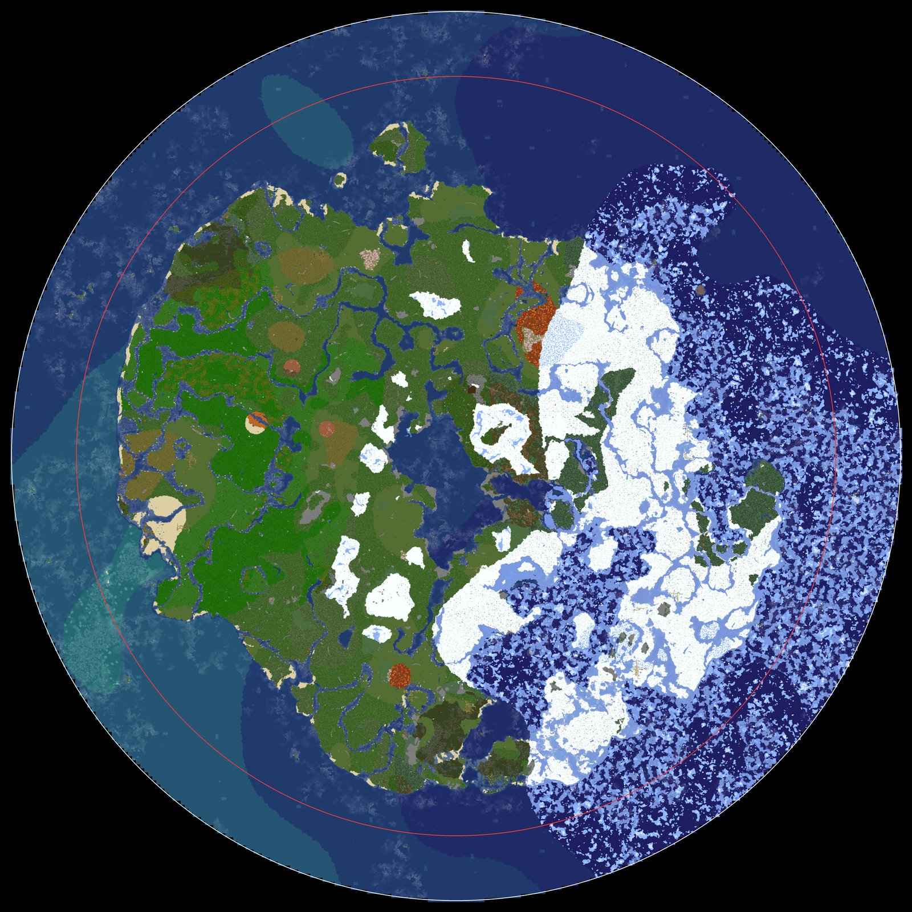
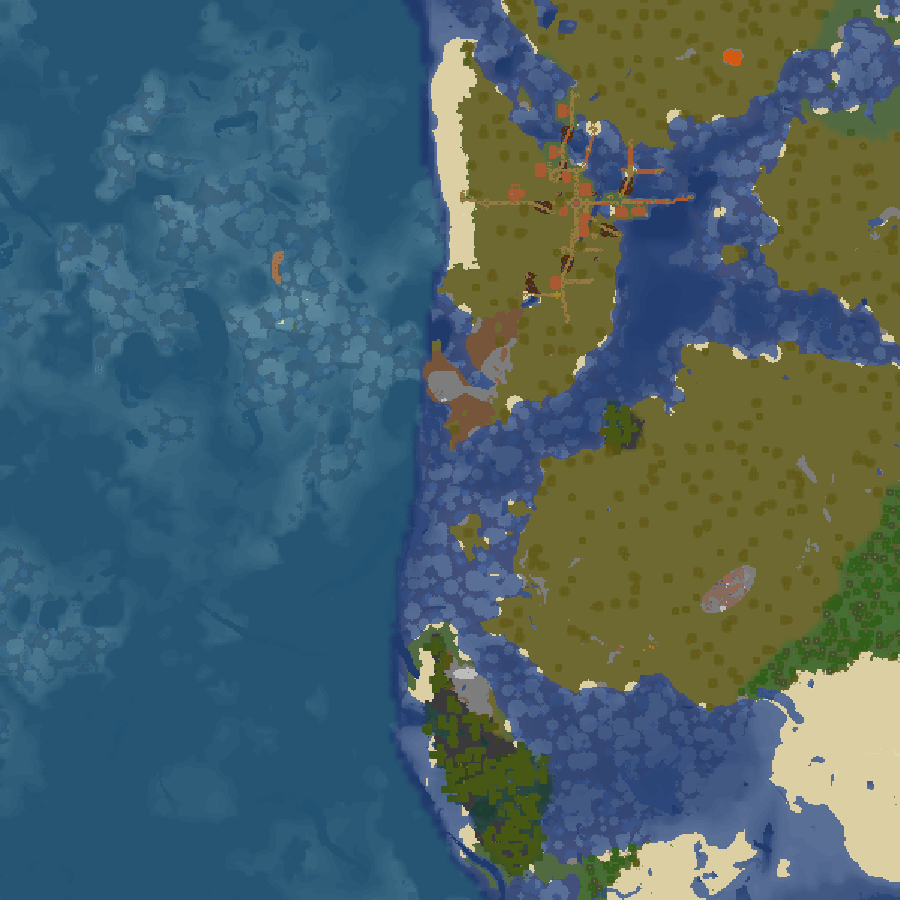
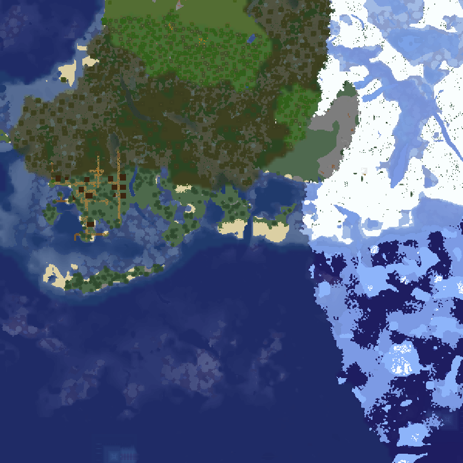

# SRV-4 · Visual check of each generated world on the map

**Priority:** P2 · **Area:** Test server · **Type:** Feature

## User story

As a developer, I want to inspect the test world on the map against the design, so the visual check the automated tests cannot do gets done.

## Description

Use SRV-3's map to check the coastline, the edge, spawn and land shape of `r3000`, the smallest and most crowded world, and write the findings where the design and EDGE-2 expect them. Each optional world from SRV-5 gets the same check.

## Current situation (as-is)

- [EDGE-2](EDGE-2.md) still has open in-game screenshots; the design doc's [Risks and open questions](../Finite%20World%20%E2%80%94%20Minecraft%20worldgen%20mod%20design.md) lists only the visual check as open (TUNE-1).
- [TEST-1](TEST-1.md) asserts the hard rules by sampling; nothing looks at a whole world.

## Desired result (to-be)

- A screenshot of each checked world from the map, with what was seen.
- Problems found become their own tickets in [PLAN.md](../PLAN.md).

## Acceptance criteria

- [x] Screenshot of `r3000`'s full map (top view, whole circle) saved and linked from this ticket. ([below](#r3000). *2026-11-21 divergence:* it is BlueMap's own lod-1 low-res tiles (1 px per block) stitched into one image, not a browser screenshot, because headless Chrome hangs on BlueMap's WebGL view. Same pixels as the web app's flat view.)
- [x] For `r3000`: no land past the radius; the coastline wanders rather than tracing a circle (EDGE-2); spawn is on land near the centre (SPAWN-1). (No land past the radius: every point above y 63 past 3,000 is an iceberg in the frozen east (snow, packed and blue ice, up to y 133 at (3124, -492), `deep_frozen_ocean`) or a shipwreck mast (planks, up to y 76). The coastline wanders everywhere except one stretch on the west: see [EDGE-3](EDGE-3.md). Spawn is at (112, 145, -32), on land 116 blocks from the centre.)
- [x] Anything that looks wrong is noted with its coordinates. (See **Findings** below.)
- [x] Findings are written into EDGE-2's in-game criteria and the design doc's Open list; each problem found gets a ticket. ([EDGE-2](EDGE-2.md) criteria annotated, design doc Risks **Open** item updated, [EDGE-3](EDGE-3.md) added to [PLAN.md](../PLAN.md).)

## r3000

Seed 12345, radius 3,000, rendered by BlueMap 5.29 (SRV-3). Red circle: the radius. White circle: the generated edge at 3,512.

| Close-up (600 × 600 blocks, 1 px per block) | |
| --- | --- |
|  | West coast around (-2,648, 185): lowland ending in beaches, but along one straight north–south line ([EDGE-3](EDGE-3.md)) |
|  | South coast around (456, 2,588), the highest ground near the outer coast (y 136 within 64 blocks of it): forest and a stony patch running to the sea. A top view can't show whether it's a cliff or an overhang; that stays with EDGE-2's in-game check |

## Findings

Measured on the stitched tiles (surface heights from BlueMap's tile metadata, checked against spawn: tile y 144, spawn y 145) and with `/locate` on the server.

- **No land past the radius.** Above sea level past radius 3,000 there are only icebergs (frozen east, up to y 133 at (3124, -492)) and shipwreck masts (planks, up to y 76, e.g. (3264, -384) and (-2688, -1472)). Both are vanilla ocean features; the design allows ocean items inside and outside the radius.
- **Coastline wanders, except on the west.** The outermost land per direction runs from 2,116 to 2,652 on the non-frozen sides. From about (-2,690, -700) to (-2,690, 1,000) the coast is a near-straight line, which at this radius is an arc of a circle: [EDGE-3](EDGE-3.md).
- **Lowland coast almost everywhere.** Only 3 of 180 rays have ground at y 100 or more within 64 blocks of the outer coast, the highest at (456, 2,588) (y 136). Seed 12345 at 3,000 has almost no mountains meeting the edge, so it can't test the cliff look; EDGE-2's seeds at 4,000 still have to.
- **Inland sea at the centre.** The centre is `minecraft:ocean`: along z = 0 there is water from x = -528 to 104. Vanilla terrain, allowed by the design (ocean items "may still appear inside the radius"); spawn moved to land 116 blocks away (SPAWN-1). Not a ticket.
- **Land ends 350 to 900 blocks inside the radius** (median about 2,450). That is the 500-block fade band plus up to 300 blocks of outline inset (decision 17), so the outer ring inside the radius is mostly shelf and ocean. As designed.
- **The east third is snow and frozen ocean**, with sea ice and icebergs reaching past the radius. Vanilla climate; reads naturally.

## Notes

- Needs SRV-3.
